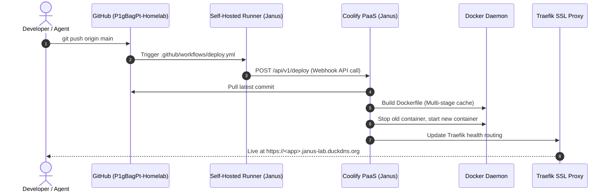

# System & Network Architecture

This document describes the networking, traffic routing, security, and container execution environment of **Project Janus** for all hosted applications.

---

## 1. Network Topology & Traffic Routing

Project Janus operates behind a standard residential router with DuckDNS Dynamic DNS (`janus-lab.duckdns.org`) and Traefik reverse proxying:

```
               [ Internet / External Users ]
                             │
                             ▼ (Ports 80 & 443 TCP)
              [ Vodafone Router Port Forwarding ]
                             │
                             ▼ (192.168.1.68)
        [ Traefik Reverse Proxy (Coolify Gateway) ]
        * Handles Let's Encrypt Wildcard SSL Certificates
        * Routes based on HTTP Host Header (*.janus-lab.duckdns.org)
                             │
             ┌───────────────┴───────────────┐
             │ Internal 'coolify' Bridge Net │
             ▼                               ▼
  [ Mini-Project Container ]      [ Shared Core Services ]
  * Port 3000 / 8000               * PostgreSQL 18 (5432)
  * Non-root user                  * Redis 7.2 (6379)
  * Direct inter-service DNS       * MinIO S3 (9000)
                                   * RabbitMQ (5672)
                                   * Ollama (11434)
```

### Key Architectural Concepts:
1. **Traefik Dynamic Routing**:
   * You do not manually write Nginx reverse proxy configuration blocks.
   * Coolify manages Traefik dynamically. When you assign `https://my-app.janus-lab.duckdns.org` in Coolify, Traefik generates Let's Encrypt certificates automatically and routes incoming traffic to your container.
2. **Internal Network Isolation**:
   * The shared databases (Postgres, Redis), object storage (MinIO), and message broker (RabbitMQ) do not expose public ports to the internet.
   * Only your application container communicates with them internally across the `coolify` Docker network.

---

## 2. CI/CD Lifecycle (Git Push to Production)

Deployments are automated through a self-hosted GitHub Actions runner running on the bare-metal server:



### Advantages of the Self-Hosted Runner:
* **Zero Cloud Costs**: Unlimited CI/CD minutes directly on local server hardware.
* **Instant Speed**: Docker build cache persists on high-speed NVMe/SSD storage.
* **Direct Network Access**: The runner can trigger Coolify deployment APIs directly over `localhost` or internal LAN without needing public exposure.
