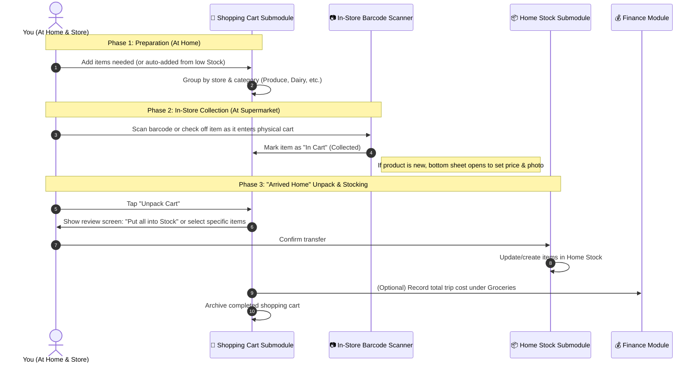
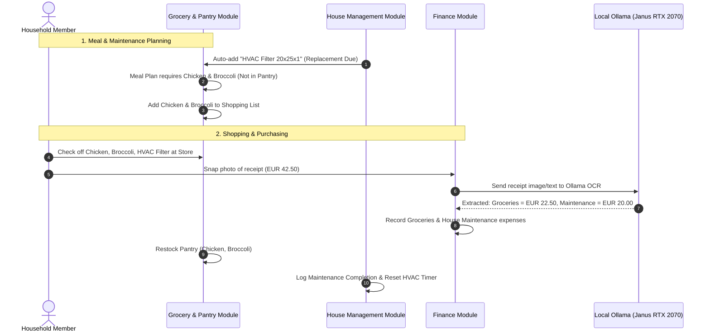

# 01. Product Vision & Feature Modules

## 1. High-Level Vision

Most modern households use fragmented apps:
* A shopping list app (e.g., Bring!, Keep)
* A task manager for house chores (e.g., Todoist, Trello)
* A personal finance / expense tracker (e.g., YNAB, Splitwise, Excel)
* Notes or folders for appliance manuals, warranties, and receipts

Because these tools are separate, **valuable context is lost**:
* When you buy groceries, you manually input the expense into your budget and manually remember what's in the fridge.
* When an appliance needs maintenance (e.g. changing an HVAC filter or water filter), that task isn't linked to the shopping list or the appliance's manual and warranty.
* When you have food expiring, no system suggests recipes to use it before it goes bad.

**The Goal**: A single, modular, mobile-first Web Application hosted on **Project Janus** that links these 3 domains into a seamless household lifecycle.

---

## 2. Pillar Breakdown

### 🏠 Pillar A: House Management

The house management module handles the physical home, its appliances, recurring maintenance, and daily operations.

#### 1. Appliance & Asset Registry
* **Asset Dossier**: Track major items (refrigerator, washing machine, HVAC, robot vacuum, lawnmower, vehicle).
* **Metadata**: Make, model, serial number, purchase date, warranty expiration date, vendor.
* **Document Locker (via MinIO S3)**: Store PDF user manuals, warranty proof documents, and installation schematics.
* **QR Code Labels**: Print physical QR stickers to attach to equipment; scanning with a phone opens the exact item dossier and maintenance history.

#### 2. Maintenance Schedules & Reminders
* **Recurring Maintenance**:
  * Seasonal: Clear gutters, inspect HVAC before winter, clean dryer vent.
  * Usage/Time-based: Descale coffee machine every 60 days, replace water filters every 6 months.
* **Service History Log**: Date serviced, cost, notes, contractor contact, or DIY steps taken.

#### 3. Chores & Daily Operations
* **Chore Delegation**: Assignable to household members with cadence (daily, weekly, bi-weekly).
* **Rotation Mode**: Automatically alternate turns (e.g., cleaning the kitchen, taking out recycling).
* **Completion Streaks / Gamification**: Quick swipe-to-complete on mobile.

#### 4. Home Inventory & Zones (Storage Management)
* **Locations**: Garage, Attic, Basement, Pantry, Medicine Cabinet, Tool Shed.
* **Box Inventory**: "What is in Attic Box #4?" Searchable inventory with photos and contents tags.

---

### 🛒 Pillar B: Grocery & Kitchen Module (2 Dedicated Submodules)

The Grocery domain is explicitly split into two interconnected submodules that mirror the real-life shopping lifecycle:

```
┌────────────────────────────────────────────────────────────────────────┐
│                        Grocery & Kitchen Module                        │
├───────────────────────────────────┬────────────────────────────────────┤
│   📦 Submodule 1: Stock Inventory │  🛒 Submodule 2: Shopping Cart     │
│   (What you have at home)         │  (Prepare -> Collect -> Unpack)    │
│   - Fridge, Pantry, Freezer       │  - Phase 1: Planning / Preparation │
│   - Levels (Full, Low, Out)       │  - Phase 2: In-Store Collection    │
│   - Expiration dates & waste alert│  - Phase 3: "Arrived Home" Transfer│
└───────────────────────────────────┴────────────────────────────────────┘
```

#### 📦 Submodule 1: Home Stock Management
* **Home Stock View**: Clear, visual inventory of what you have at home across locations (Fridge, Dry Pantry, Freezer, Cleaning & Household).
* **Inventory State**:
  * Status badges: **In Stock** 🟢, **Running Low** 🟡, **Out of Stock** 🔴.
  * Quantities & units (e.g. 2 cartons, 500g, 1 bottle).
  * Optional expiration tracking for perishables.
* **1-Tap "Replenish"**: Tapping "Running Low" or a dedicated `[+ Add to Cart]` button instantly queues the item onto the active Shopping Cart.
* **Quick Deplete / Consume**: Fast slider or minus button to decrement items as you cook.

---

#### 🛒 Submodule 2: Shopping Cart (The 3-Phase Lifecycle)

This submodule manages the complete shopping journey from preparation to putting items away in your kitchen cupboards:



##### Phase 1: Preparation (At Home)
* Build the cart before leaving home.
* Items can be added manually, by scanning empty containers at home, or pushed from low Stock.
* Displays estimated basket total based on catalog prices.

##### Phase 2: In-Store Collection Mode (At the Store)
* Mobile-optimized checklist view.
* As you place physical items into your shopping cart, you:
  * **Scan the barcode** using the camera scanner (which immediately checks it off and verifies price), OR
  * **Tap to collect** the item on the screen.
* Items move to a distinct "Collected in Cart" section with running subtotal.

##### Phase 3: "Arrived Home" Unpack & Stock Transfer
* When you get home from the supermarket, tap the **"Unpack Cart"** button.
* An interactive unpack screen appears:
  * Option A: **"Put All into Stock"** (1-click transfer).
  * Option B: **Select specific items** to put into stock (e.g., you bought a snack to eat immediately vs pantry essentials to store).
* Selected items automatically update or create records in **Submodule 1 (Home Stock)** with status `in_stock`.
* Prompts to log the final receipt total in the Finance module.

---

### 🔔 Prepared Notification Engine (Dormant Mode)
* **Status**: Prepared in database schema and service abstraction (`INotificationService`), but disabled/dormant until needed.
* **Extensible Handlers**: Interface ready for WebPush, Telegram Bot, or Discord alerts without touching core business logic when activated.

---

### 💰 Pillar C: Personal & Household Finance

Designed to give clear financial visibility without enterprise complexity, while managing shared living costs.

#### 1. Budgeting & Expense Tracking
* **Category Buckets**: Groceries, Dining Out, Utilities, Home Maintenance, Subscriptions, Entertainment.
* **Monthly Budgets & Alerts**: Visual progress bars per category with over-budget warnings.
* **Multi-Account Tracking**: Track checking accounts, credit cards, or cash buffers.

#### 2. Recurring Subscriptions & Fixed Bills Calendar
* **Contract/Subscription Vault**: Netflix, Spotify, Internet, Gym, Electricity, Insurance.
* **Renewal Alerts**: Notice before annual renewals or contract price hikes.
* **Monthly Burn Rate Projection**: Automatic calculation of fixed baseline expenses before discretionary spending.

#### 3. Shared Household Split / Ledger (Splitwise Replacement)
* **Shared Expenses vs Personal**: Mark expenses as 50/50, custom ratio, or 100% individual.
* **Settlement Engine**: "Who owes whom how much?" Simple net settlement balance calculations.

#### 4. Receipt Archival & OCR Parsing
* **Digital Vault (MinIO)**: Capture receipt photos immediately after purchase.
* **Automated Data Extraction**: Extract store name, date, total amount, and line items.

---

## 3. The Power of Cross-Module Synergies (Why One System?)

The true value of this unified platform lies in the automated handoffs between the 3 modules:



### Synergy Highlights:
1. **Pantry <-> Shopping <-> Finance**:
   * Buying items on the shopping list updates the pantry stock AND logs the expense under "Groceries".
2. **Maintenance <-> Shopping <-> Finance**:
   * Changing a water filter creates a task, queues the filter on the shopping list, and when bought, attributes the cost to "Home Maintenance".
3. **Pantry <-> AI Meal Suggestions**:
   * The local Ollama model can suggest meals specifically based on items currently in the pantry that expire in the next 48 hours.
4. **Appliance <-> Warranty <-> Finance**:
   * If an appliance breaks, the dossier has the original purchase receipt, warranty expiration date, and past service costs readily accessible.

---

## 4. Local AI Superpowers (Running on Janus RTX 2070)

Because Project Janus runs Ollama with GPU acceleration on the internal network (`http://ollama:11434`), we can embed privacy-respecting AI capabilities at zero recurring API cost:

| Feature | AI Role | Model Candidate |
| :--- | :--- | :--- |
| **Receipt Extraction** | Parse OCR text into JSON with vendor, date, line items, and taxes. | `llama3.1:8b` or `mistral:7b` |
| **Pantry Rescue Cook** | "I have eggs, half an onion, cheddar, and stale sourdough. What can I make in 15 mins?" | `llama3.1:8b` |
| **Transaction Categorizer**| Automatically map raw bank description (e.g. `LIDL STORE #4912 LISBON`) to category `Groceries`. | `phi3:mini` |
| **Natural Language Quick-Add** | Single input bar: *"Bought olive oil for 4.50 and need to clean dishwasher tomorrow"* -> parses into 1 expense, 1 inventory update, 1 chore. | `llama3.1:8b` |
