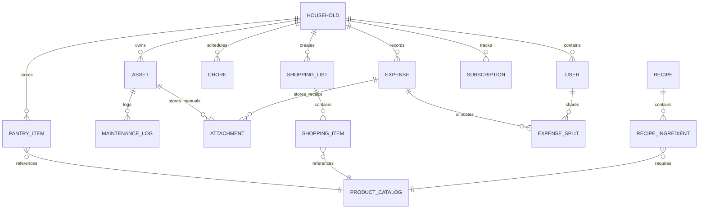

# 02. Architecture & Janus Core Services Integration

## 1. Architectural Style: Why a "Modular Monolith"?

When designing a system with 3 clear sub-domains (House, Grocery, Finance), teams often ask: **Separate Microservices or One Monolith?**

### Recommendation: Modular Monolith

For a homelab host (Project Janus bare-metal running Coolify), a **Modular Monolith** provides the ideal balance:

```
┌────────────────────────────────────────────────────────────────────────┐
│                          Nook Web Application                          │
├──────────────────┬───────────────────┬─────────────────────────────────┤
│  🏠 House Module │ 🛒 Grocery Module │        💰 Finance Module        │
│  - Assets        │ - Shopping Lists  │        - Expenses & Budget      │
│  - Maintenance   │ - Pantry & Stock  │        - Subscriptions          │
│  - Chores        │ - Recipes & Meals │        - Split Settlement       │
├──────────────────┴───────────────────┴─────────────────────────────────┤
│                  Core Shared Services / Domain Kernel                  │
│  - Authentication & Household Users                                    │
│  - Notification Engine (WebPush / Telegram / Email)                   │
│  - File Storage Interface (MinIO)                                      │
│  - Background Queue & Workers (RabbitMQ / Redis)                       │
│  - Local AI Inference Client (Ollama)                                  │
└────────────────────────────────────────────────────────────────────────┘
```

### Why this beats Microservices for this project:
1. **Zero Network Latency Between Modules**: Linking a grocery list item to a finance expense is a simple, type-safe database transaction rather than an eventual-consistency distributed saga.
2. **Simplified Coolify & Docker Deployment**: Exactly **one web container** (or one web + one worker container) running on the `coolify` Docker network, saving CPU and RAM on the host.
3. **Strict Codebase Decoupling**: Each module maintains its own folder, domain models, services, and routes (`src/modules/house`, `src/modules/grocery`, `src/modules/finance`). They interact only via defined internal interfaces. If a module ever needs to scale independently later, it can be extracted effortlessly.

---

## 2. Infrastructure Mapping to Project Janus

As specified in [base-project/AGENT_INSTRUCTIONS.md](../base-project/AGENT_INSTRUCTIONS.md), we do not spin up private database containers. We consume Janus's centralized infrastructure:

```
┌────────────────────────────────────────────────────────────────────────┐
│                        Traefik Reverse Proxy                           │
│           https://home.janus-lab.duckdns.org (Port 443 SSL)            │
└───────────────────────────────────┬────────────────────────────────────┘
                                    │
                                    ▼
┌────────────────────────────────────────────────────────────────────────┐
│                        Nook Container (API + Web)                      │
│               (Joined to external 'coolify' network)                   │
└───────┬──────────────┬──────────────┬──────────────┬────────────┬──────┘
        │              │              │              │            │
        ▼              ▼              ▼              ▼            ▼
┌──────────────┐┌──────────────┐┌──────────────┐┌───────────┐┌───────────┐
│  Postgres 18 ││  Redis 7.2   ││   MinIO S3   ││ RabbitMQ  ││ Ollama AI │
│  port 5432   ││  port 6379   ││  port 9000   ││ port 5672 ││port 11434 │
│ (DB: nook_   ││ (DB Index 3) ││(Bucket:      ││(VHost:    ││(RTX 2070  │
│    db)       ││              ││  nook-media) ││  /nook)   │  Models)   │
└──────────────┘└──────────────┘└──────────────┘└───────────┘└───────────┘
```

| Service | Janus Endpoint | Usage in Nook |
| :--- | :--- | :--- |
| **PostgreSQL 18** | `postgres:5432` | Relational database (`nook_db`). Stores users, chores, maintenance logs, assets, pantry items, shopping lists, receipts, and ledger transactions. |
| **Redis 7.2** | `redis:6379/3` | Real-time shopping list collaborative sync (WebSockets / SSE state), session tokens, ephemeral rate limiting, and cache for quick lookups. |
| **MinIO S3** | `http://minio:9000` | S3 bucket `nook-media`. Stores appliance user manual PDFs, warranty scan PDFs, item QR codes, receipts, and photos. |
| **RabbitMQ** | `amqp://rabbitmq:5672` | Dedicated vhost `/janus-home`. Background asynchronous processing: processing receipt OCR jobs, sending scheduled push notifications, computing monthly balance reports. |
| **Ollama AI** | `http://ollama:11434` | Hardware-accelerated (RTX 2070 GPU). Receipt text parsing, meal ideas from expiring pantry items, natural language task parsing. |
| **GlitchTip** | `http://glitchtip-web:8000` | Crash and error forensics (`SENTRY_DSN`). |
| **Prometheus** | Scrapes `/metrics` | Container and API response time monitoring in Grafana. |

---

## 3. High-Level Data Model & Cross-Domain Entities

Below is the conceptual relational layout across the 3 domains:



### Core Data Tables:

#### 1. Identity & Household
* `households`: Multi-user or single family boundaries.
* `users`: Member profiles, avatars, notification preferences, roles (Admin, Member, Viewer).

#### 2. House Management Domain
* `assets`: Name, room/zone, brand, model, serial_number, purchase_date, warranty_until, notes.
* `maintenance_tasks`: Asset reference, cadence (days/months), last_performed, next_due_date, instructions.
* `maintenance_logs`: Task reference, completed_by, cost, receipt_id, notes.
* `chores`: Title, frequency, rotation_type, assigned_user_id, status, streak_count.

#### 3. Grocery & Pantry Domain
* `product_catalog`: Standardized barcode (EAN/UPC), name, default_category, standard_unit (kg, g, l, pcs).
* `pantry_items`: Catalog reference, quantity, unit, location (Fridge, Freezer, Dry Pantry), expiry_date, status.
* `shopping_lists`: Name (e.g. "Weekly Groceries", "IKEA Trip"), store, status (active, completed).
* `shopping_items`: List reference, catalog reference, quantity, checked, added_by, notes.
* `recipes`: Title, prep_time, cook_time, instructions, servings.
* `recipe_ingredients`: Recipe reference, catalog reference, quantity, unit.

#### 4. Finance Domain
* `categories`: Groceries, Utilities, House Maintenance, Subscriptions, Dining, etc.
* `expenses`: Household reference, payer_id, amount, currency, category_id, date, description, receipt_attachment_id.
* `expense_splits`: Expense reference, user_id, share_amount, settled (boolean).
* `subscriptions`: Name, amount, billing_cycle (monthly, annual), next_billing_date, payment_method, active.
* `attachments`: File key in MinIO (`janus-home`), original filename, mime_type, file_size, uploaded_by.

---

## 4. Performance & High-Speed API Engineering

To achieve **ultra-fast API response times (<10-25ms)** and eliminate latency bottlenecks:

```
┌────────────────────────────────────────────────────────────────────────┐
│                        Performance Pipeline                            │
├────────────────────────────────────────────────────────────────────────┤
│ 1. Direct Presigned S3 Uploads (MinIO)                                 │
│    Product photos stream directly from Mobile Client -> MinIO S3.     │
│    The application API never gets bogged down proxying large images.   │
├────────────────────────────────────────────────────────────────────────┤
│ 2. Drizzle ORM + Prepared SQL Statements                              │
│    Zero ORM overhead, zero query parsing lag. Executes raw-speed      │
│    Postgres SQL with strict TypeScript safety.                         │
├────────────────────────────────────────────────────────────────────────┤
│ 3. Redis 7.2 Catalog & Active List Hot Cache                          │
│    Frequently scanned barcodes & active grocery lists live in Redis.   │
│    Lookups return in sub-millisecond time.                             │
├────────────────────────────────────────────────────────────────────────┤
│ 4. Single-Roundtrip Mutation Payloads                                 │
│    Scanning an item and adding it returns the updated list state in    │
│    one network roundtrip; no redundant GET waterfalls.                │
└────────────────────────────────────────────────────────────────────────┘
```

---

## 5. UI/UX Design System: Minimalist & Joyful

* **Philosophy**: Minimalist, clean, uncluttered, with **subtle, happy colors** that make daily home management feel light and enjoyable rather than bureaucratic.
* **Palette**:
  * **Canvas / Background**: Warm off-white / porcelain (`#FAFAF8`), dark mode deep charcoal (`#141416`).
  * **Cards & Surfaces**: Pure white cards with soft, feathered ambient shadows (`shadow-sm` / `shadow-md`).
  * **Joyful Accent Highlights**:
    * 🍑 *Warm Peach / Apricot* (`#FF8A65` / `#FF7043`) for primary actions & finance highlights.
    * 🌿 *Fresh Sage / Mint* (`#48BB78` / `#38A169`) for pantry stock, completed chores, and items bought.
    * ☀️ *Warm Butter / Sunshine* (`#F6AD55`) for maintenance alerts and expiry warnings.
    * 🍇 *Soft Lavender / Iris* (`#805AD5`) for house management and documents.
* **Mobile Ergonomics**:
  * Bottom floating action bar with thumb-accessible "Scan" button in the center.
  * Native haptic feedback vibrations on barcode detection (`navigator.vibrate(50)`).
  * Swipe-to-delete and swipe-to-complete gestures.

---

## 6. Mobile & Real-Time Considerations

Because grocery shopping and house chores happen on the go (in the kitchen, store aisles, garage):
1. **Mobile-First Responsive PWA**: Standalone manifest, full-bleed viewport (`viewport-fit=cover`), touch ripple effects, home screen installable.
2. **Online-First (Zero Offline Baggage)**: Keeping it online-only removes the overhead of complex client CRDTs/offline sync engines. The UI uses optimistic local rendering so checkmarks and scans react in 0ms while sending the request in the background.
3. **Hardware Barcode Detection**: Utilizes the modern browser `BarcodeDetector` API (leveraging device GPU/camera hardware) with `@zxing` fallback.
