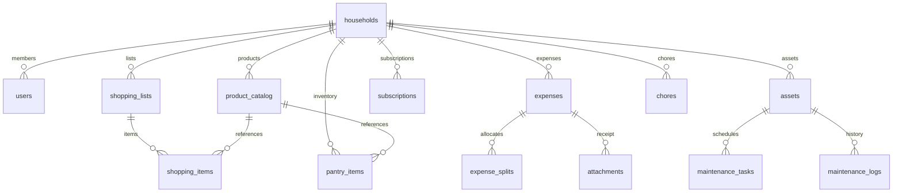

# 04. Database Schema Specification (PostgreSQL 18 & Drizzle ORM)

> **Database**: PostgreSQL 18 on `postgres:5432`  
> **Database Name**: `janus_home_db`  
> **Target Network**: `coolify` Docker network  
> **ORM**: Drizzle ORM with TypeScript & prepared SQL statements  

---

## 1. Schema Overview & Architecture Rules

1. **UUIDv7 / UUID Primary Keys**: Every table uses standard UUIDs (or nanoid/cuid2) for primary keys to prevent enumeration attacks and allow client-side optimistic ID generation.
2. **Multi-Tenant Household Partitioning**: All records (`product_catalog`, `shopping_lists`, `expenses`, `assets`) belong to a `household_id`. Multiple family members belong to the same household.
3. **Prepared Query Optimization**: High-frequency lookups (`barcode`, `household_id`, `shopping_list_id`) have explicit B-tree indexes.



---

## 2. Drizzle Table Definitions

### A. Core Household & Users

```typescript
import { pgTable, text, timestamp, uuid, boolean, integer, numeric, index } from "drizzle-orm/pg-core";

// Households
export const households = pgTable("households", {
  id: uuid("id").defaultRandom().primaryKey(),
  name: text("name").notNull(), // e.g. "My Nook"
  currency: text("currency").default("EUR").notNull(),
  createdAt: timestamp("created_at", { withTimezone: true }).defaultNow().notNull(),
  updatedAt: timestamp("updated_at", { withTimezone: true }).defaultNow().notNull(),
});

// Users & Admin-Controlled Authentication
export const users = pgTable("users", {
  id: uuid("id").defaultRandom().primaryKey(),
  householdId: uuid("household_id").references(() => households.id, { onDelete: "cascade" }).notNull(),
  email: text("email").notNull().unique(),
  name: text("name").notNull(),
  avatarUrl: text("avatar_url"),
  passwordHash: text("password_hash"), // Nullable initially for invited users
  mustSetPassword: boolean("must_set_password").default(false).notNull(), // True for users invited by admin
  inviteToken: text("invite_token").unique(), // 1-time activation token for first login
  inviteTokenExpiresAt: timestamp("invite_token_expires_at", { withTimezone: true }),
  role: text("role", { enum: ["admin", "member", "viewer"] }).default("member").notNull(),
  createdAt: timestamp("created_at", { withTimezone: true }).defaultNow().notNull(),
  updatedAt: timestamp("updated_at", { withTimezone: true }).defaultNow().notNull(),
}, (t) => [
  index("idx_users_household").on(t.householdId),
  index("idx_users_email").on(t.email),
  index("idx_users_invite").on(t.inviteToken),
]);

// User Sessions (HTTP-Only Cookie Session Management)
export const sessions = pgTable("sessions", {
  id: text("id").primaryKey(), // Session token
  userId: uuid("user_id").references(() => users.id, { onDelete: "cascade" }).notNull(),
  expiresAt: timestamp("expires_at", { withTimezone: true }).notNull(),
  createdAt: timestamp("created_at", { withTimezone: true }).defaultNow().notNull(),
}, (t) => [
  index("idx_sessions_user").on(t.userId),
]);
```

---

### B. Grocery, Barcode Catalog & Pantry

```typescript
// Master Product Catalog (Scanned & Digitalized Products)
export const productCatalog = pgTable("product_catalog", {
  id: uuid("id").defaultRandom().primaryKey(),
  householdId: uuid("household_id").references(() => households.id, { onDelete: "cascade" }).notNull(),
  barcode: text("barcode").notNull(), // EAN-13, UPC, Code128
  title: text("title").notNull(),
  brand: text("brand"),
  description: text("description"),
  category: text("category").default("General").notNull(), // Produce, Dairy, Bakery, Frozen, Beverage, Household, etc.
  unit: text("unit").default("pcs").notNull(), // pcs, kg, g, l, ml, pack
  defaultPrice: numeric("default_price", { precision: 10, scale: 2 }), // In household currency
  imageKey: text("image_key"), // MinIO S3 object key (e.g. products/<uuid>.webp)
  createdAt: timestamp("created_at", { withTimezone: true }).defaultNow().notNull(),
  updatedAt: timestamp("updated_at", { withTimezone: true }).defaultNow().notNull(),
}, (t) => [
  index("idx_catalog_barcode").on(t.householdId, t.barcode),
  index("idx_catalog_category").on(t.householdId, t.category),
]);

// Shopping Lists (Supports Preparation -> Shopping -> Unpack Lifecycle)
export const shoppingLists = pgTable("shopping_lists", {
  id: uuid("id").defaultRandom().primaryKey(),
  householdId: uuid("household_id").references(() => households.id, { onDelete: "cascade" }).notNull(),
  title: text("title").notNull(), // e.g. "Weekly Groceries", "Supermarket Run"
  storeName: text("store_name"), // e.g. "Lidl", "Continente", "Pingo Doce"
  status: text("status", { enum: ["preparing", "shopping", "completed", "archived"] }).default("preparing").notNull(),
  completedAt: timestamp("completed_at", { withTimezone: true }),
  unpackedAt: timestamp("unpacked_at", { withTimezone: true }),
  createdAt: timestamp("created_at", { withTimezone: true }).defaultNow().notNull(),
  updatedAt: timestamp("updated_at", { withTimezone: true }).defaultNow().notNull(),
}, (t) => [
  index("idx_shopping_lists_household").on(t.householdId),
  index("idx_shopping_lists_status").on(t.householdId, t.status),
]);

// Shopping List Items (Collected in Cart -> Transferred to Stock)
export const shoppingItems = pgTable("shopping_items", {
  id: uuid("id").defaultRandom().primaryKey(),
  listId: uuid("list_id").references(() => shoppingLists.id, { onDelete: "cascade" }).notNull(),
  productId: uuid("product_id").references(() => productCatalog.id, { onDelete: "set null" }),
  customTitle: text("custom_title"), // Used if item not in catalog
  quantity: numeric("quantity", { precision: 10, scale: 2 }).default("1.0").notNull(),
  unit: text("unit").default("pcs").notNull(),
  estimatedPrice: numeric("estimated_price", { precision: 10, scale: 2 }),
  isCollected: boolean("is_collected").default(false).notNull(), // Picked in supermarket cart
  collectedAt: timestamp("collected_at", { withTimezone: true }),
  isTransferredToStock: boolean("is_transferred_to_stock").default(false).notNull(), // Transferred when unpacked at home
  transferredAt: timestamp("transferred_at", { withTimezone: true }),
  targetLocation: text("target_location").default("Pantry"), // Where to put it when home (Fridge, Pantry, Freezer)
  notes: text("notes"),
  createdAt: timestamp("created_at", { withTimezone: true }).defaultNow().notNull(),
}, (t) => [
  index("idx_shopping_items_list").on(t.listId),
  index("idx_shopping_items_collected").on(t.listId, t.isCollected),
]);

// Pantry & Inventory
export const pantryItems = pgTable("pantry_items", {
  id: uuid("id").defaultRandom().primaryKey(),
  householdId: uuid("household_id").references(() => households.id, { onDelete: "cascade" }).notNull(),
  productId: uuid("product_id").references(() => productCatalog.id, { onDelete: "cascade" }).notNull(),
  location: text("location").default("Pantry").notNull(), // Fridge, Freezer, Dry Pantry, Spice Rack
  status: text("status", { enum: ["in_stock", "running_low", "out_of_stock"] }).default("in_stock").notNull(),
  quantity: numeric("quantity", { precision: 10, scale: 2 }).default("1.0").notNull(),
  unit: text("unit").default("pcs").notNull(),
  expiryDate: timestamp("expiry_date", { withTimezone: true }),
  openedAt: timestamp("opened_at", { withTimezone: true }),
  updatedAt: timestamp("updated_at", { withTimezone: true }).defaultNow().notNull(),
}, (t) => [
  index("idx_pantry_household").on(t.householdId),
  index("idx_pantry_status").on(t.householdId, t.status),
  index("idx_pantry_expiry").on(t.householdId, t.expiryDate),
]);
```

---

### C. Personal & Household Finance

```typescript
// Expense Categories
export const expenseCategories = pgTable("expense_categories", {
  id: uuid("id").defaultRandom().primaryKey(),
  householdId: uuid("household_id").references(() => households.id, { onDelete: "cascade" }).notNull(),
  name: text("name").notNull(), // Groceries, Home Maintenance, Utilities, Dining, Subscriptions
  color: text("color").default("#FF8A65").notNull(), // Hex color for joyful accents
  monthlyBudget: numeric("monthly_budget", { precision: 10, scale: 2 }),
});

// Expenses
export const expenses = pgTable("expenses", {
  id: uuid("id").defaultRandom().primaryKey(),
  householdId: uuid("household_id").references(() => households.id, { onDelete: "cascade" }).notNull(),
  paidByUserId: uuid("paid_by_user_id").references(() => users.id, { onDelete: "restrict" }).notNull(),
  categoryId: uuid("category_id").references(() => expenseCategories.id, { onDelete: "set null" }),
  amount: numeric("amount", { precision: 10, scale: 2 }).notNull(),
  date: timestamp("date", { withTimezone: true }).defaultNow().notNull(),
  title: text("title").notNull(),
  receiptKey: text("receipt_key"), // MinIO S3 object key
  isSplit: boolean("is_split").default(false).notNull(),
  createdAt: timestamp("created_at", { withTimezone: true }).defaultNow().notNull(),
}, (t) => [
  index("idx_expenses_household_date").on(t.householdId, t.date),
  index("idx_expenses_category").on(t.categoryId),
]);

// Shared Expense Splits
export const expenseSplits = pgTable("expense_splits", {
  id: uuid("id").defaultRandom().primaryKey(),
  expenseId: uuid("expense_id").references(() => expenses.id, { onDelete: "cascade" }).notNull(),
  userId: uuid("user_id").references(() => users.id, { onDelete: "cascade" }).notNull(),
  shareAmount: numeric("share_amount", { precision: 10, scale: 2 }).notNull(),
  isSettled: boolean("is_settled").default(false).notNull(),
  settledAt: timestamp("settled_at", { withTimezone: true }),
}, (t) => [
  index("idx_splits_user_settled").on(t.userId, t.isSettled),
]);

// Recurring Subscriptions & Fixed Bills
export const subscriptions = pgTable("subscriptions", {
  id: uuid("id").defaultRandom().primaryKey(),
  householdId: uuid("household_id").references(() => households.id, { onDelete: "cascade" }).notNull(),
  name: text("name").notNull(), // Netflix, Internet, Electricity, Gym
  amount: numeric("amount", { precision: 10, scale: 2 }).notNull(),
  billingCycle: text("billing_cycle", { enum: ["monthly", "annual", "quarterly"] }).default("monthly").notNull(),
  nextBillingDate: timestamp("next_billing_date", { withTimezone: true }).notNull(),
  isActive: boolean("is_active").default(true).notNull(),
});
```

---

### D. House Management (Assets & Maintenance)

```typescript
// Home Assets & Appliances
export const assets = pgTable("assets", {
  id: uuid("id").defaultRandom().primaryKey(),
  householdId: uuid("household_id").references(() => households.id, { onDelete: "cascade" }).notNull(),
  name: text("name").notNull(), // Refrigerator, HVAC, Washing Machine, Car
  roomLocation: text("room_location"), // Kitchen, Laundry, Garage
  brand: text("brand"),
  model: text("model"),
  serialNumber: text("serial_number"),
  purchaseDate: timestamp("purchase_date", { withTimezone: true }),
  warrantyUntil: timestamp("warranty_until", { withTimezone: true }),
  manualKey: text("manual_key"), // MinIO S3 object key (PDF)
  qrCodeToken: text("qr_code_token").unique(),
  createdAt: timestamp("created_at", { withTimezone: true }).defaultNow().notNull(),
});

// Maintenance Schedules
export const maintenanceTasks = pgTable("maintenance_tasks", {
  id: uuid("id").defaultRandom().primaryKey(),
  assetId: uuid("asset_id").references(() => assets.id, { onDelete: "cascade" }).notNull(),
  title: text("title").notNull(), // Replace water filter, Descale coffee machine
  frequencyDays: integer("frequency_days").notNull(), // e.g. 90 days
  lastPerformedDate: timestamp("last_performed_date", { withTimezone: true }),
  nextDueDate: timestamp("next_due_date", { withTimezone: true }).notNull(),
  instructions: text("instructions"),
}, (t) => [
  index("idx_maint_due_date").on(t.nextDueDate),
]);

// Chores & Operations
export const chores = pgTable("chores", {
  id: uuid("id").defaultRandom().primaryKey(),
  householdId: uuid("household_id").references(() => households.id, { onDelete: "cascade" }).notNull(),
  title: text("title").notNull(), // Clean kitchen, Take out recycling
  cadence: text("cadence", { enum: ["daily", "weekly", "biweekly", "monthly"] }).default("weekly").notNull(),
  assignedUserId: uuid("assigned_user_id").references(() => users.id, { onDelete: "set null" }),
  streakCount: integer("streak_count").default(0).notNull(),
  lastCompletedAt: timestamp("last_completed_at", { withTimezone: true }),
});
```

---

### E. Dormant Notification Engine Tables

```typescript
// Notification Logs (Prepared for future activation)
export const notificationLogs = pgTable("notification_logs", {
  id: uuid("id").defaultRandom().primaryKey(),
  householdId: uuid("household_id").references(() => households.id, { onDelete: "cascade" }).notNull(),
  userId: uuid("user_id").references(() => users.id, { onDelete: "set null" }),
  channel: text("channel", { enum: ["webpush", "telegram", "discord", "email"] }).notNull(),
  category: text("category").notNull(), // chore_due, bill_reminder, item_expired
  title: text("title").notNull(),
  body: text("body").notNull(),
  status: text("status", { enum: ["queued", "sent", "failed", "disabled"] }).default("disabled").notNull(),
  sentAt: timestamp("sent_at", { withTimezone: true }),
  createdAt: timestamp("created_at", { withTimezone: true }).defaultNow().notNull(),
});
```
