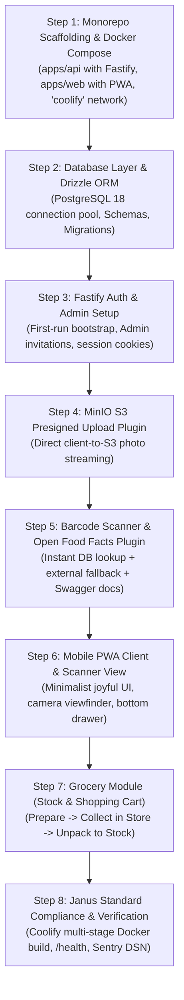

# 07. Step-by-Step Agent Implementation Plan

> **Audience**: AI Agents (Antigravity, Cursor, Copilot, Claude Code) & Developers  
> **Deployment Target**: Project Janus Homelab (`base-project` foundation)  
> **Architecture**: Decoupled Monorepo (Dedicated Fastify API + Dedicated Mobile PWA)  

This document serves as the **executable, step-by-step master plan**. Each task contains clear inputs, files to create/modify, verification commands, and acceptance criteria.

---

## 🚦 Invariant Rules for AI Agents (Do Not Skip!)

1. **NEVER add `postgres`, `redis`, or `minio` containers to docker-compose**. Connect directly to Janus shared infrastructure (`postgres:5432`, `redis:6379/3`, `minio:9000`).
2. **ALWAYS connect the application containers to the external `coolify` network**.
3. **ALWAYS preserve mandatory endpoints**: `GET /health` and `GET /metrics`.
4. **ALWAYS use Presigned S3 URLs** for camera photo uploads to MinIO. The application API must never stream heavy binary image files.

---

## 📋 Phase 1: MVP — Monorepo, Dedicated Fastify API & Barcode Scanner PWA



---

### Step 1: Monorepo Scaffolding & Docker Compose

* **Objective**: Set up the project workspace with `apps/api` (Fastify TypeScript), `apps/web` (Vite React PWA), `bruno/` test collection, and `.spectral.yaml`.
* **Tasks**:
  1. Initialize monorepo root `package.json` with npm/pnpm workspaces:
     ```json
     {
       "name": "janus-home",
       "private": true,
       "workspaces": ["apps/*"]
     }
     ```
  2. Create `apps/api`:
     ```bash
     mkdir -p apps/api/src
     cd apps/api && npm init -y
     npm install fastify @fastify/cors @fastify/cookie @fastify/swagger @scalar/fastify-api-reference @fastify/sensible dotenv zod
     npm install -D typescript @types/node tsx
     ```
  3. Create `apps/web`:
     ```bash
     npm create vite@latest apps/web -- --template react-ts
     cd apps/web && npm install tailwindcss lucide-react vaul framer-motion clsx tailwind-merge @tanstack/react-query
     ```
  4. Create `bruno/` directory at the root with `bruno.json`, `environments/Local.bru`, and `environments/Janus-Prod.bru`.
  5. Create `.spectral.yaml` OpenAPI linting config at root.
  6. Create `docker-compose.yml` linking `apps/api` (port 8000) and `apps/web` (port 3000) joined to the external `coolify` network.
* **Verification**: Run `npm run dev` in `apps/api` and verify Fastify starts on port 8000 with Scalar docs at `http://localhost:8000/docs`.

---

### Step 2: Database Layer & Drizzle ORM Setup

* **Objective**: Connect Fastify to PostgreSQL 18 via connection pooling and generate database migrations with Drizzle ORM.
* **Tasks**:
  1. In `apps/api`, install Drizzle and `pg`:
     ```bash
     npm install drizzle-orm pg
     npm install -D drizzle-kit @types/pg
     ```
  2. Create `apps/api/src/plugins/database.ts`:
     - Initializes `pg.Pool` connected to `process.env.DATABASE_URL` (`postgresql://...:5432/janus_home_db`).
     - Exports `fastify.db` decorator.
  3. Create `apps/api/src/lib/db/schema.ts` defining all tables from [04_DATABASE_SCHEMA_SPEC.md](./04_DATABASE_SCHEMA_SPEC.md).
  4. Generate and run migrations: `npx drizzle-kit generate` & `npx drizzle-kit migrate`.
* **Verification**: Verify Fastify starts and logs successful connection to PostgreSQL 18.

---

### Step 3: Fastify Auth Plugin & Admin Setup

* **Objective**: Implement the Admin-controlled authentication engine in Fastify.
* **Tasks**:
  1. In `apps/api`, install `argon2` and `jose`:
     ```bash
     npm install argon2 jose
     ```
  2. Create `apps/api/src/modules/auth/routes.ts`:
     - `GET /api/auth/status`: Returns `initialized: boolean`.
     - `POST /api/auth/setup`: First-run setup creating Admin and Household (only permitted when 0 users exist).
     - `POST /api/auth/login`: Email/password verification and HTTP-only session cookie issuance.
     - `POST /api/admin/invite-user`: Admin creates a member and returns a 1-time activation code.
     - `POST /api/auth/set-password`: First-login password setup.
     - `GET /api/auth/me`: Returns current authenticated user.
  3. Create `apps/api/src/plugins/auth-guard.ts` Fastify hook to authenticate protected routes.
* **Verification**: Execute `/setup` via Swagger at `http://localhost:8000/docs`, verify Admin created, verify public signup is impossible.

---

### Step 4: MinIO S3 Presigned Upload Plugin

* **Objective**: Enable mobile PWA clients to stream photos directly to MinIO S3.
* **Tasks**:
  1. In `apps/api`, install `@aws-sdk/client-s3` and `@aws-sdk/s3-request-presigner`.
  2. Create `apps/api/src/plugins/s3.ts`:
     - Initializes `S3Client` with `process.env.S3_ENDPOINT` (`http://minio:9000`), credentials, and `forcePathStyle: true`.
  3. Create route `POST /api/uploads/presigned-url`:
     - Validates folder (`products`, `receipts`, `manuals`) and content type.
     - Returns `{ uploadUrl, fileKey, publicUrl }`.
* **Verification**: Request a presigned URL and successfully upload a test image directly from terminal/client to MinIO bucket `janus-home`.

---

### Step 5: Barcode Scanner & Open Food Facts Plugin

* **Objective**: Create the ultra-fast barcode lookup and product creation endpoints in Fastify.
* **Tasks**:
  1. Create `apps/api/src/modules/catalog/routes.ts`:
     - `GET /api/catalog/scan/:barcode`:
       1. Queries `productCatalog` by `householdId` and `barcode` (<2ms).
       2. If missing, queries Open Food Facts API and returns pre-filled product details.
     - `POST /api/catalog/products`: Creates/digitalizes new product record with photo key, title, price, brand, and category.
     - `GET /api/catalog/products`: Search and filter catalog items.
* **Verification**: Test `/api/catalog/scan/5601009941123` via Swagger UI at `/docs`.

---

### Step 6: Mobile PWA Client & Scanner View (`apps/web`)

* **Objective**: Build the mobile PWA with the joyful minimalist design system, camera viewfinder, and product bottom drawer.
* **Tasks**:
  1. Configure Tailwind CSS with the subtle joyful tokens (warm porcelain canvas, peach, sage, amber).
  2. Implement `apps/web/src/components/scanner/BarcodeScannerView.tsx`:
     - Uses `BarcodeDetector` API with `@zxing/browser` fallback.
     - Vibrates on scan (`navigator.vibrate?.(40)`).
  3. Implement `apps/web/src/components/products/ProductCreateDrawer.tsx` with `Vaul`:
     - Glides up when barcode is scanned.
     - 1-tap camera snap uploading directly to MinIO via presigned URL.
     - Price, brand, category, title inputs.
* **Verification**: Open PWA on smartphone, scan physical barcode, snap photo, save product to Fastify backend.

---

### Step 7: Grocery Module (Home Stock & Shopping Cart Submodules)

* **Objective**: Complete the two submodules: **My Stock** and the 3-phase **Shopping Cart** (Prepare -> Collect in Store -> Unpack to Stock).
* **Tasks**:
  1. Create Fastify routes in `apps/api/src/modules/cart/` and `apps/api/src/modules/stock/`:
     - `GET /api/cart/active` & `POST /api/cart/items`
     - `PATCH /api/cart/items/:id` (toggle collected in cart)
     - `POST /api/cart/unpack` (transfers collected items into Home Stock)
     - `GET /api/stock` & `PATCH /api/stock/:id`
  2. Build the PWA views:
     - Top segmented switch: `[ 🛒 Shopping Cart ]` and `[ 📦 My Stock ]`.
     - In-store checklist mode.
     - "Arrived Home? Unpack to Stock" drawer.
* **Verification**: Complete a full cycle: Prepare cart ➔ Scan & collect items ➔ Unpack to Stock ➔ Verify items in My Stock inventory.

---

### Step 8: Comprehensive Test Suite, Bruno & Playwright E2E Setup

* **Objective**: Implement Unit tests (Vitest), Integration tests (Fastify `server.inject()`), Bruno smoke tests (`bru run`), Spectral OpenAPI linting, and Playwright E2E mobile flows.
* **Tasks**:
  1. Configure **Vitest** in both `apps/api` and `apps/web`:
     - Unit tests for validation schemas, barcode parser, and UI components.
     - Fastify integration tests testing full HTTP routes and database transactions.
  2. Implement **Bruno** collections in `bruno/`:
     - `01-Health`: Tests for `/healthz`, `/readyz`, and `/version`.
     - `02-Auth`: Tests for first-run setup, login, member invitation.
     - `03-Catalog`: Tests for barcode lookup and product creation.
     - `04-Cart`: Tests for adding items, collecting, and unpacking to stock.
  3. Configure **Spectral** contract linting (`spectral lint openapi.json`).
  4. Configure **Playwright** at root for mobile browser automation:
     - Install Playwright: `npm install -D @playwright/test`
     - Create `playwright.config.ts` with Pixel 7 and iPhone 14 mobile devices.
  5. Implement critical E2E test specs in `e2e/`:
     - `auth-setup.spec.ts`: First-run Admin setup & Member invite + password set.
     - `barcode-digitalize.spec.ts`: Scanning barcode, opening drawer, saving product with price and photo.
     - `grocery-lifecycle.spec.ts`: Add to cart ➔ In-store collect ➔ Unpack to Stock ➔ Verify in My Stock.
  6. Wire tests into `.github/workflows/deploy.yml` on the self-hosted Janus runner:
     - Step 1: Run Vitest unit & integration tests.
     - Step 2: Spin up local container and verify `/healthz`.
     - Step 3: Run `spectral lint openapi.json`.
     - Step 4: Run `bru run bruno --env Local --bail`.
     - Step 5: Run Playwright mobile tests.
     - Step 6: Trigger Coolify deployment webhook!
* **Verification**: Run `npm run test`, `bru run bruno --env Local`, and `npm run test:e2e`; verify all tests pass with 100% green status.

---

### Step 9: Janus Standard Compliance & Docker Deployment

* **Objective**: Ensure all Project Janus homelab operational rules are satisfied.
* **Tasks**:
  1. Expose `GET /health` (pings Postgres and MinIO) and `GET /metrics`.
  2. Initialize Sentry SDK with `process.env.SENTRY_DSN` pointing to GlitchTip.
  3. Write production multi-stage Dockerfiles:
     - `apps/api/Dockerfile`: Node.js 22 alpine, non-root `node` user.
     - `apps/web/Dockerfile`: Multi-stage build outputting static assets to Nginx Alpine (<10MB RAM).
  4. Ensure containers run on the external `coolify` network.
* **Verification**: Run `docker compose build` and verify all containers build cleanly and join the external `coolify` network.

---

### Step 1: Scaffolding & Base Project Configuration

* **Objective**: Create the Next.js 15 application skeleton with TypeScript, Tailwind CSS, Shadcn UI primitives, and PWA configuration matching the `base-project` template.
* **Tasks**:
  1. Initialize Next.js 15 in the workspace:
     ```bash
     npx create-next-app@latest . --typescript --tailwind --eslint --app --src-dir --import-alias "@/*" --use-npm
     ```
  2. Copy and configure `templates/Dockerfile.nodejs` from `base-project` to the root as `Dockerfile`.
  3. Ensure `next.config.ts` outputs `output: "standalone"`.
  4. Create `public/manifest.json` with PWA standalone configuration, theme color `#FAFAF8`, and mobile icons.
  5. Install foundational dependencies:
     ```bash
     npm install lucide-react clsx tailwind-merge vaul framer-motion @radix-ui/react-dialog @radix-ui/react-slot
     ```
  6. Implement the base layout with the mobile floating bottom dock (Grocery, Pantry, Scan Button, Finance, House).
* **Verification**: Run `npm run build` and ensure zero compilation errors.

---

### Step 2: Database Layer & Admin-Controlled Auth Setup

* **Objective**: Establish the PostgreSQL 18 connection pool, execute Drizzle migrations, and implement the Admin-controlled authentication engine (First-Run Admin Setup + Admin-only Member Invitations).
* **Tasks**:
  1. Install Drizzle ORM, `pg`, and password hashing:
     ```bash
     npm install drizzle-orm pg dotenv argon2 jose
     npm install -D drizzle-kit @types/pg
     ```
  2. Create `src/lib/db/index.ts` initializing the `Pool` and `drizzle` client connected to `process.env.DATABASE_URL`.
  3. Create `src/lib/db/schema.ts` defining:
     - `households`, `users` (with `mustSetPassword`, `inviteToken`), and `sessions`
     - `product_catalog` (with composite index on `household_id` + `barcode`)
     - `shopping_lists` (with lifecycle `status`) & `shopping_items` (`is_collected`, `is_transferred_to_stock`)
     - `pantry_items`
     - `notification_logs` (dormant table)
  4. Create `src/lib/auth/session.ts` handling secure HTTP-only cookies and Argon2 password hashing.
  5. Implement Auth Route Handlers:
     - `GET /api/auth/status`: Checks if initial admin setup is required.
     - `POST /api/auth/setup`: First-run wizard creating the first user as Admin.
     - `POST /api/auth/login`: Standard login.
     - `POST /api/admin/invite-user`: Admin provisions new member and returns activation link.
     - `POST /api/auth/set-password`: First login password setter for invited users.
  6. Create UI views:
     - `/setup`: Minimalist first-run onboarding screen (Admin + Household creation).
     - `/login`: Minimalist login card (no public sign-up link).
     - `/join`: Set password screen for invited members.
* **Verification**: Run migrations on Postgres 18. Access the app to verify `/setup` is triggered, create the Admin, verify public signup is blocked, and test inviting a member.

---

### Step 3: MinIO S3 Presigned Upload Engine

* **Objective**: Provide an endpoint where mobile clients can request secure PUT URLs to upload photos directly to MinIO S3.
* **Tasks**:
  1. Install AWS S3 SDK:
     ```bash
     npm install @aws-sdk/client-s3 @aws-sdk/s3-request-presigner
     ```
  2. Create `src/lib/s3/client.ts`:
     - Initializes `S3Client` with `process.env.S3_ENDPOINT` (`http://minio:9000`), credentials, and `forcePathStyle: true`.
  3. Create Route Handler `src/app/api/uploads/presigned-url/route.ts`:
     - Validates payload with Zod (`folder`, `fileExtension`, `contentType`).
     - Generates UUID file key: `products/<uuid>.<ext>`.
     - Calls `getSignedUrl(s3Client, new PutObjectCommand(...), { expiresIn: 300 })`.
     - Returns `uploadUrl`, `fileKey`, and `publicUrl`.
* **Verification**: Test with `curl` or Postman to confirm valid presigned URL generation and direct file PUT to MinIO.

---

### Step 4: Barcode Scanner & Open Food Facts Engine

* **Objective**: Build the camera scanner hook and the fast barcode lookup service.
* **Tasks**:
  1. Install `@zxing/browser` and `@zxing/library` as fallback:
     ```bash
     npm install @zxing/browser @zxing/library
     ```
  2. Create `src/lib/services/barcode-service.ts`:
     - Function `resolveBarcode(barcode: string, householdId: string)`:
       1. Queries `productCatalog` by `householdId` and `barcode`. If found, returns `source: "local"`.
       2. If not found, calls Open Food Facts API:
          `https://world.openfoodfacts.org/api/v2/product/${barcode}.json`
       3. If matched, extracts `product_name`, `brands`, `categories`, and `image_url` and returns `source: "openfoodfacts"`.
       4. If not matched, returns `source: "not_found"`.
  3. Create Route Handler `src/app/api/products/scan/[barcode]/route.ts`.
  4. Create `src/components/scanner/BarcodeScannerView.tsx`:
     - Accesses `navigator.mediaDevices.getUserMedia`.
     - Uses `window.BarcodeDetector` if available, falling back to `@zxing/browser`.
     - Triggers subtle haptic vibration (`navigator.vibrate?.(40)`).
* **Verification**: Open camera view on mobile, scan a sample barcode (e.g. standard milk or coffee carton), confirm it resolves.

---

### Step 5: Product Digitalization Bottom Sheet

* **Objective**: When a new or uncataloged barcode is scanned, open a sleek bottom sheet to snap a photo, input price, title, and save.
* **Tasks**:
  1. Create `src/components/products/ProductCreateDrawer.tsx` using `Vaul`:
     - Header: "✨ Digitalize Product" + Barcode badge.
     - 1-tap Camera snap: Reads file via `<input type="file" accept="image/*" capture="environment">`.
     - Directly calls `/api/uploads/presigned-url` and PUTs image to MinIO.
     - Input fields: Title (pre-filled), Brand, Category (pill selector), Default Price (€), Unit.
     - Buttons:
       - *"Save & Add to Shopping List"*
       - *"Save to Catalog Only"*
  2. Create Route Handler `POST /api/products`:
     - Inserts product record into `productCatalog`.
* **Verification**: Digitalize a product with photo and price; verify record in PostgreSQL and image file in MinIO bucket.

---

### Step 6: Grocery Module (Home Stock & Shopping Cart Submodules)

* **Objective**: Build the 2-submodule grocery system: **My Stock** management and the 3-phase **Shopping Cart** (Prepare -> Collect in Store -> Unpack to Stock).
* **Tasks**:
  1. Build **Submodule 1: Home Stock Management**:
     - Route handlers for `GET /api/stock` and `PATCH /api/stock/[id]`.
     - Filter chips: All, Fridge, Dry Pantry, Freezer, Cleaning.
     - Status badges: In Stock 🟢, Running Low 🟡, Out of Stock 🔴.
     - 1-tap `[+ Add to Cart]` button that pushes the item to the active shopping cart.
  2. Build **Submodule 2: Shopping Cart (3-Phase Lifecycle)**:
     - **Preparation Mode**: Add items manually or push from low stock; estimated total.
     - **In-Store Collection Mode**:
       - Camera barcode scan checks off items as they enter physical basket.
       - Manual tap to collect with instant optimistic checkmark and haptic tap.
       - Items move to "Collected in Cart" section.
     - **"Arrived Home" Unpack Drawer**:
       - Action button: *"Arrived Home? Unpack to Stock"*.
       - Route handler `POST /api/shopping-lists/[id]/unpack`.
       - Supports "Put All into Stock" or selective transfer.
       - Automatically increments or creates stock items in Submodule 1.
       - Optional prompt: record expense in Finance module.
* **Verification**: Prepare a cart, collect 3 items via barcode/tap, click "Unpack to Stock", verify items reflect in Home Stock inventory.

---

### Step 7: System Endpoints, Docker & Coolify Verification

* **Objective**: Ensure all Project Janus standards and automated deployment checks pass.
* **Tasks**:
  1. Create `src/app/health/route.ts`:
     - Pings Postgres 18 (`SELECT 1`) and MinIO.
     - Returns `{"status": "ok", "database": "connected"}`.
  2. Create `src/app/metrics/route.ts`: Exposes Prometheus metrics.
  3. Wire Sentry SDK to GlitchTip (`process.env.SENTRY_DSN`).
  4. Test Docker build locally:
     ```bash
     docker build -t janus-home:test .
     ```
* **Verification**: Container builds successfully, starts under non-root user, and responds with HTTP 200 on `/health`.

---

## 📅 Roadmap: Subsequent Phases

### 💰 Phase 2: Personal & Household Finance
* **Task 2.1**: Category-based expense tracking (Groceries, Home, Dining, Utilities).
* **Task 2.2**: Recurring subscriptions calendar with monthly burn rate projection.
* **Task 2.3**: Shared household split ledger ("Who owes whom" settlement).
* **Task 2.4**: Automated grocery checkout loop: Completing a shopping trip prompts for receipt total and logs it under the "Groceries" category.

### 🏠 Phase 3: House Management
* **Task 3.1**: Appliance dossier & asset registry with MinIO PDF manual uploads.
* **Task 3.2**: Recurring maintenance schedules with countdown timers (HVAC, water filters).
* **Task 3.3**: Chores rotation engine and mobile checklist.
* **Task 3.4**: Printable QR labels for physical household assets.

### 🧠 Phase 4: Local AI (Janus RTX 2070 Ollama) & Notification Activation
* **Task 4.1**: Receipt OCR parsing using local Ollama model to auto-extract vendor and line items.
* **Task 4.2**: "Pantry Rescue Cook": AI meal suggestions based on ingredients expiring in 48 hours.
* **Task 4.3**: Notification Engine Activation: Wire Telegram Bot and WebPush handlers into the dormant notification module.
